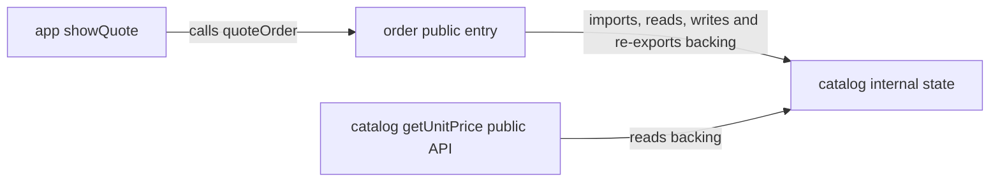

# Architecture views and boundary conformance — 12 October 2026

## Thoughts review assessment

Read the finished “Thoughts” turn and its [current architecture report](/Users/gaz/.codex/worktrees/0f13/calm-astrophage/.reports/astrophage-architecture-first-pass-20261012.md). The output now contains four Mermaid blocks and two annotated code-tree blocks: current capability relationships; current code organization; preparation execution; email recovery; and an observed/native-host/portable-decision comparison with corresponding current/proposed paths.

These meet the requested content: arrows have stated meanings; logical modules are distinguished from deployment tiers; the actual gateway callback direction is explained; required and optional work are separated; retained identities/atomic commits remain visible; proposals are clearly unaccepted alternatives with unresolved interfaces. The views are scoped source traces, not a complete dependency graph. Visual Mermaid layout remains unverified; this task inspected the Markdown content without a rendering check.

The report supports understanding the boundaries. It does not establish conformance of a future implementation: both selected contracts remain proposals and the optional portable API lacks concrete event/result schemas. No new product defect or accepted target was inferred from its diagrams. The report's 56 passing checks are its recorded evidence, not a fresh execution by this task.

## Research and interpretation

| Term                                    | Practical interpretation and limit                                                                                                                                                                               | Primary source                                                                                           |
| --------------------------------------- | ---------------------------------------------------------------------------------------------------------------------------------------------------------------------------------------------------------------- | -------------------------------------------------------------------------------------------------------- |
| Information hiding                      | Hide a changeable policy or representation behind useful operations. Processing order and file divisions alone do not establish such a boundary.                                                                 | [Parnas](https://www.cs.lafayette.edu/~gexia/cs301/resources/parnas.html)                                |
| Encapsulation                           | Use module operations/access controls to maintain that boundary. A private field is insufficient if callers receive the mutable backing object. This is our working application of information hiding.           | [Parnas](https://www.cs.lafayette.edu/~gexia/cs301/resources/parnas.html)                                |
| Leaky abstraction                       | Callers depend on details the interface purports to hide. Some runtime constraints such as partial failure remain real and should be explicit guarantees/limits.                                                 | [Spolsky](https://www.joelonsoftware.com/2002/11/11/the-law-of-leaky-abstractions/)                      |
| Least knowledge                         | Use the meaningful public operation without traversing another component's collaborator structure. This adapts an OO rule; declared record-field access is not automatically forbidden.                          | [Lieberherr / Demeter team](https://www.ccs.neu.edu/home/lieber/LoD.html)                                |
| Dependency direction                    | Runtime calls and source dependencies differ. Provider/database representation must not accidentally become a portable policy dependency. Apply the chosen contract without forcing a four-layer architecture.   | [Martin](https://blog.cleancoder.com/uncle-bob/2012/08/13/the-clean-architecture.html)                   |
| Architectural drift / fitness functions | Check implementation against the selected architectural qualities during evolution. Existing visibility/lint/import/runtime checks can provide feedback; new tooling and arbitrary scores are not prerequisites. | [Thoughtworks](https://www.thoughtworks.com/en-us/insights/articles/fitness-function-driven-development) |

Legitimate use of a declared API, data schema or native transaction is not an abstraction leak merely because it crosses a module. The important question is whether code respects the recorded guarantees and dependencies. Intentional host coupling and authorized legacy exceptions remain visible rather than being condemned by style preference.

## Applied skill changes

- Design records consequential public/private, dependency, state/effect and responsibility limits as checkable obligations.
- Discovery and audit inspect representation leaks, indirect imports/re-exports, state access, moved policy and scope drift against those obligations. Boundary findings can annotate diagrams with public crossings and obligation IDs.
- Implementation stays inside the boundary while editing and performs an explicit final conformance check over the scoped diff and affected consumers/composition. Selected in-scope violations must be corrected; unrelated issues are reported. A required boundary change is reconciled through design under existing authorization, never silently accepted to make code fit.
- Completion/verified status requires both behavior and boundary evidence. Known violations and material unverified limits remain gaps, even when the functional suite is green. Static enforcement, review evidence and remaining uncertainty are distinguished.

The default contract stays compact; detailed conformance and research terminology reside in the existing optional references. No new skill, enforcement framework or product-specific reusable rule was added.

## Independent behavioral trial

One evaluator received the updated audit and implementation skills plus a raw isolated order/catalog fixture, without this task's suspected issues or conclusions. It first audited the accepted contract, then implemented it within a narrowly authorized source/document scope. Catalog sources, behavior spec, existing public test, package, instructions and app caller were protected.

Before the fix, the existing public arithmetic test passed. The audit found one C2/B2 boundary failure with three manifestations: order imported catalog internals, re-exported the mutable backing object and incremented catalog state. A runtime probe confirmed correct arithmetic alongside that state mutation and leaked export. Prior C2 verification was stale.

The evaluator replaced the implementation with an import of the existing public getUnitPrice operation and a simple multiplication. It removed the export/write without adding layers, APIs, validation policy or dependencies. The public test still passed. Focused probes passed for supported quantities/zero, changed-price reads, app integration, unchanged/frozen backing state and the sole public quote export. Contract/catalog evidence was renewed without weakening C1/C2.

Parent checks independently confirmed the protected public test still passes on Node 24.19.0, inspected the full final source/documents and matched all seven protected input contents to the original baseline. Structural conformance is source-reviewed; the fixture has no continuously enforced import/visibility rule. This is a narrow successful trial, not proof that all future agent implementations will conform automatically.

Fresh source checks: four Skill Creator validators, explicit-only metadata/prompt checks, local file/section links, scoped formatting and whitespace/diff checks passed. Package layout/resources did not change, so prior packaging evidence was retained rather than repeated. Product source, contracts, provider/backend state and the Thoughts report were read-only here; no message was sent to that chat. No installation, commit, push, publication or deployment occurred.

## Captured fixture records

The temporary fixture was removed after capture. Fenced records below are historical data; relative links and NODE24 commands refer to that fixture and the evaluator's documented executable.

### audit.md

````text
# Order quote contract audit

Baseline: inspected fixture source on 2026-10-12, before implementation changes. Scope: `src/order/index.ts`, its app/public-test callers, catalog public and internal modules, `specs/order.md`, the selected contract and architecture catalog. The fixture is not a Git repository (`git status --short` reports that fact), so source snapshots and SHA-256 fingerprints provide the baseline. No inputs were edited during this audit.

Authority: `specs/order.md` B1–B2 and the explicitly accepted target in `docs/architecture/contracts/order.md`. C1 and C2 retain their existing meaning; no target revision or extra business behavior is needed.

## Current violation: C2 / B2

`src/order/index.ts:1–5` bypasses catalog's public API by importing `catalogBacking` from `../catalog/internal.ts`, re-exports it at line 2, and increments `catalogBacking.readCount` at line 4. These are one boundary failure with three manifestations: reliance on private representation, accidental public exposure of that representation, and a catalog-state write during quoting.

The baseline runtime probe returned `36` for quantity `3` but changed the backing object from `{"unitPrice":12,"readCount":0}` to `{"unitPrice":12,"readCount":1}`. The order module's runtime exports were `["catalogBacking","quoteOrder"]`. Thus supported arithmetic success does not establish read-only behavior or boundary conformance.

Scoped remedy: import catalog's existing `getUnitPrice` operation from `../catalog/index.ts`, multiply quantity by its current result, and remove the backing-object export and state write. Keep the `quoteOrder` signature and app caller intact. No catalog modification, new layer, dependency, API, policy or toolchain change is necessary.

Observed baseline relationships, checked against all four source files:



```text
src/app.ts                public order caller; no catalog dependency
src/order/index.ts        quote API; current bypass/export/write violates C2
src/catalog/index.ts      existing supported price-read API
src/catalog/internal.ts   catalog-owned mutable backing representation
test/public.test.mjs      protected public C1/B1 arithmetic test
```

## Evidence freshness and status

C1: the existing public test was rerun under Node v24.19.0 with `node --test test/public.test.mjs`: 1 passed, 0 failed. It checks quantity 3 and zero at the initial price. It does not prove dynamic price reads, read-only quoting, export privacy, or app integration.

C2: the contract's earlier source review explicitly predates implementation changes and is not bound to this source. Current inspection and the runtime probe contradict its verified claim. The contract and architecture catalog's `verified` statuses cannot describe this baseline. This is stale verification evidence/status, not a stale obligation or an unaccepted proposed target.

No missing implementation for C1 was found. C2 remains an implementation gap until the remedy and fresh structural/state checks pass. Fresh checks should cover the changed operation, dynamic current-price use, supported quantities and zero, affected app caller, read-only state, and public exports.

Inspection limits: all fixture product sources and the existing public test were read. No wider product, release, invalid/out-of-type input policy, persistent state, network integration or database behavior is within this scope. The existing toolchain has no compiler/lint/import-enforcement command; boundary review and focused runtime probes can establish current-source conformance but do not add ongoing enforcement.
````

### evidence.md

````text
# Order quote conformance evidence

Completed on 2026-10-12 in `/private/tmp/calm-contract-boundaries-20261012/fixture`. Runtime: `/Users/gaz/.local/share/fnm/node-versions/v24.19.0/installation/bin/node`, v24.19.0, native TypeScript stripping and ESM as defined by the unchanged package. No network, installation, external state or Git mutation occurred. The fixture is not a Git repository; baseline file contents and SHA-256 hashes were captured before implementation. No prior reports or other trials were read.

Used the requested local `code-contract-audit` and `code-contract-implement` skills, after reading system `skill-creator`, fixture instructions, the short contract guide and relevant boundary conformance guidance. The baseline finding is saved in [audit.md](audit.md), written before implementation inputs changed.

## Final change and conformance

Only product change: `src/order/index.ts` imports `getUnitPrice` from `../catalog/index.ts`, and `quoteOrder` returns `quantity * getUnitPrice()`. The private backing import, backing re-export and `readCount` increment were removed. Its signature and supported arithmetic remain unchanged. The app's existing `showQuote` caller needs no change. No new layer, API, quantity policy, dependency, framework, entry point or effect was introduced.

Final order source SHA-256: `38b453d48d58d91853b754944683ce875febf9a443f2588cad5b9d41621fb8f8`. Baseline order source SHA-256: `8b56ca945378f8bce83713e4cecb9333d3cf4ad4945cae07ee7439b579adc1e4`.

| Obligation | Evidence and result | Evidence kind |
| --- | --- | --- |
| C1 / B1: supported quantities use current catalog price, including zero | Protected public test: 1 passed; focused checks exercise 0, 1, 3, 10 through order and app, then a process-local price change from 12 to 7.5 produces 22.5 for quantity 3 | Runtime assertions |
| C2 / B2: quote is read-only | Full backing state unchanged after order/app calls; frozen backing still permits zero and positive quotes | Runtime assertions and source review |
| C2: only catalog public dependency; no private representation or re-export | All four source modules reviewed; order's only import is `getUnitPrice` from catalog's public entry; its body only multiplies by that operation. Runtime exports are exactly `["quoteOrder"]` | Reviewed import/state/effect path plus runtime export assertion |
| C2: affected composition has no indirect bypass | App imports and calls only `quoteOrder`; no app alias/re-export of catalog exists. Catalog public operation reads its own internal price without writes. No other source consumers or dynamic imports exist | Full scoped source review |

The documented current relationship is now `app.showQuote -> order.quoteOrder -> catalog.getUnitPrice -> catalog-owned backing read`. The baseline audit diagram deliberately preserves the pre-change structure; it is not a current architecture claim. Contract and catalog evidence status were refreshed, with prior evidence retained as history. C1/C2 meanings were not weakened or revised.

## Exact checks

All commands below ran with the fixture as working directory, using the Node path above (`NODE24` in the displayed commands denotes that literal executable path, not an installed command or shell variable).

1. `git status --short`: exit 128, not a Git repository. Used source snapshots/hashes instead; no Git operation was needed.
2. Baseline and final: `NODE24 --test test/public.test.mjs`: exit 0 on both runs, 1 test passed, 0 failed. Existing test remained untouched.
3. Baseline state/export probe (exit 0):

```sh
NODE24 --input-type=module -e "import {quoteOrder} from './src/order/index.ts'; import {catalogBacking} from './src/catalog/internal.ts'; import * as order from './src/order/index.ts'; const before = {...catalogBacking}; const result = quoteOrder(3); console.log(JSON.stringify({before,result,after:catalogBacking,exports:Object.keys(order)}));"
```

Output: `{"before":{"unitPrice":12,"readCount":0},"result":36,"after":{"unitPrice":12,"readCount":1},"exports":["catalogBacking","quoteOrder"]}`.

4. Final behavior, state and app integration checks (exit 0):

```sh
NODE24 --input-type=module <<'NODE'
import assert from 'node:assert/strict';
import * as order from './src/order/index.ts';
import {showQuote} from './src/app.ts';
import {getUnitPrice} from './src/catalog/index.ts';
import {catalogBacking} from './src/catalog/internal.ts';
assert.deepEqual(Object.keys(order), ['quoteOrder']);
const original = {...catalogBacking};
for (const quantity of [0, 1, 3, 10]) {
  assert.equal(order.quoteOrder(quantity), quantity * getUnitPrice());
  assert.equal(showQuote(quantity), quantity * getUnitPrice());
}
assert.deepEqual(catalogBacking, original);
catalogBacking.unitPrice = 7.5;
const changed = {...catalogBacking};
assert.equal(order.quoteOrder(3), 22.5);
assert.equal(showQuote(3), 22.5);
assert.deepEqual(catalogBacking, changed);
Object.freeze(catalogBacking);
assert.equal(order.quoteOrder(0), 0);
assert.equal(order.quoteOrder(4), 30);
assert.equal(showQuote(4), 30);
assert.deepEqual(catalogBacking, changed);
console.log('PASS: sole public quote export, supported quantities, app integration, current changed price, unchanged state and frozen backing');
NODE
```

The probe accesses internals solely as a verification observer/setup in an ephemeral Node process, not as an implementation dependency or persisted catalog update. Its local mutation and freeze do not modify catalog source or other processes. No new test file was added, and the protected test was not expanded.

5. `rg -n 'import|export|catalog|quoteOrder|readCount|unitPrice' src` and full reads of every source file: confirmed public app/order/catalog dependency direction, sole order export and absence of an order/app state write or indirect re-export. This is a reviewed boundary check, not a general-purpose static enforcer.
6. `NODE24 --version`: exit 0, `v24.19.0`.
7. Baseline capture and final protection check used `node:fs` and `node:crypto` to compute SHA-256 hashes of all original files. An initial capture one-liner had one extra closing parenthesis and exited 1 with `SyntaxError: Unexpected token ')'`; it did not execute or change files. The corrected heredoc capture succeeded before implementation. Final assertions compare each protected file and unchanged app against its captured hash and exit 0.

Protected/unchanged hashes checked:

| File | SHA-256 |
| --- | --- |
| AGENTS.md | `7fee10316ac103e1ae7f1d281155ff68a2f3747a56a9aca16f4a92865f7e7757` |
| package.json | `a297e28e7583bf0b3099bf1a0ba701af17c49b92bc9fd6762a36695535caede1` |
| specs/order.md | `a997b0ba0dfc009c669572e754557eb311e0f9295dc1c1f23293507b68fde725` |
| src/catalog/index.ts | `8e4b75528e543c43dd0ca492608035c332b6adaee81b11a701218e2d1cdd3498` |
| src/catalog/internal.ts | `e51d97e4d55025e7098d415abd82b717737bafcd4cccd179010bea71fcc56eaf` |
| test/public.test.mjs | `1b63fadd2f413c3bb47c2faa8e0f62f200443e6ca94f76fcbcacf9a7dfb5bb4d` |
| src/app.ts | `acf7f125e8e5a8c2be312d351e7ebe8ddc8283cbfecdba6a4f2d5248fb214cc5` |

Final diff review covers the three changed originals (`src/order/index.ts`, contract evidence, architecture catalog evidence) and two new requested reports (`audit.md`, `evidence.md`). Protected files and app are unchanged. No scratch/test files were introduced.

## Limits, remaining gaps and instruction assessment

No remaining implementation or material current-source evidence gap exists for selected C1/C2. Runtime probes cover representative supported quantities; the source expression establishes the general supported multiplication rule. Invalid/out-of-type input behavior remains outside the accepted change. No lint/compiler/package boundary enforcer is configured; C2's structural aspects are source-reviewed and do not claim ongoing automatic enforcement. There was no need for an installation, repository-wide gate or product-wide audit.

No instruction required an unnecessary implementation layer or behavioral extension. The short guide and boundary guidance usefully prevented treating a passing arithmetic test as complete conformance, and justified retaining old evidence as history while refreshing it. The requested skill-creator read was not operationally needed for this product fixture and did not trigger skill edits or skill validation. Framework migration, design revision, durable effects, authorization, public-library release policy, generalized architecture enforcement and new test-file workflows were unnecessary here and were not invoked. A compact baseline boundary diagram is adequate; no whole-product architecture map was needed.
````

### src/order/index.ts

```text
import {getUnitPrice} from '../catalog/index.ts';
export function quoteOrder(quantity: number): number {
 return quantity * getUnitPrice();
}
```

### docs/architecture/contracts/order.md

```text
---
id: order-quote
status: verified
---
# Order quote
Authority: specs/order.md B1–B2, selected accepted target. Public entry: src/order/index.ts, quoteOrder(quantity: number): number.
C1 (verified): return quantity multiplied by the current catalog unit price for supported quantities. Evidence: fresh public B1 test and supported-quantity, changed-price and app-caller checks on 2026-10-12; see [evidence](../../../evidence.md).
C2 (verified): import catalog only through src/catalog/index.ts and its getUnitPrice public operation. Do not import or re-export src/catalog/internal.ts, expose catalog backing representation, or write catalog state. Catalog internals belong to catalog. Evidence: fresh full-source/caller review, public-export and read-only/frozen-state checks on 2026-10-12; see [evidence](../../../evidence.md). Static boundary rules are reviewed, not continuously enforced by a compiler/linter.
Structure: the order module depends on the catalog public API; app calls the order public API. No new entry points, dependencies, persistence or extra business features are part of this contract.

Prior evidence retained as history: C1's public B1 test passed previously. C2's earlier source review preceded subsequent implementation changes and was not a fingerprint of this source. The [baseline audit](../../../audit.md) found that C2 and the prior verified status no longer conformed; the current evidence supersedes that review without changing either obligation.
```

## Final source fingerprints

These identify the final local source. Selected-scope wording was clarified during the trial; the evaluator record identifies the resources it used.

```text
4e4d1a0e34cdea4acb9587f57bd93fba06187f1cf56945a9bf3dc1476e187f98  references/coding-contracts.md
4c83385e73b9f61cf4bc7cea82f5327c78c77fbb0fe8411aa5307bb80e7d3d8b  references/code-contract-details.md
6dd6a26fd5036c37026739e92045041968a4a5cd403590b884cf52a06ee73cea  references/architecture-principles.md
3c1b403a94bee595167bc494eb5f5393b37b826474842a22256975327d53dfea  skills/code-contract-discover/SKILL.md
ae282aa226d6bde3e18e43d5a00d0f19f709489497ae6fe3c94653b4c4197aff  skills/code-contract-design/SKILL.md
c619b4fd4ea4d68b53735dd2c4457cf65d1fc7b9aba92cdaf77f71d9a3e62f7d  skills/code-contract-implement/SKILL.md
419f173b0941836a76785bc5d490db0975a875abcbc5c9cc72480693f1161ab5  skills/code-contract-audit/SKILL.md
```
